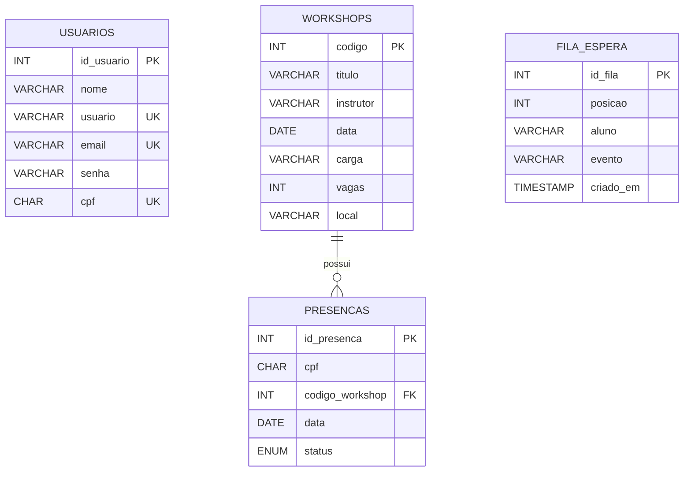

# Modelo Relacional Normalizado — EventsGym (EVG)

As tabelas possuem chave primária própria; atributos são atômicos (1FN), os atributos não-chave dependem da chave inteira (2FN) e não há dependências transitivas entre atributos não-chave (3FN). A presença referencia o workshop por chave estrangeira. O CPF pode ser associado a um usuário cadastrado, mas permanece opcional no cadastro da tela original.
